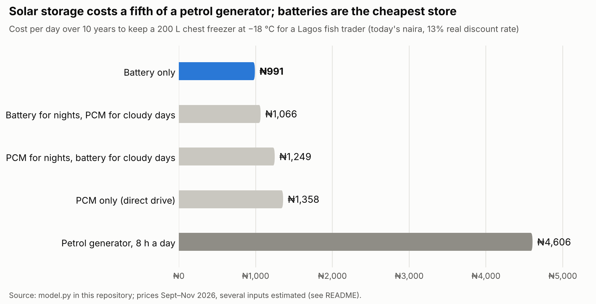

# Battery or cold? Storage for a solar chest freezer in Lagos

A solar freezer for a fish trader has to keep fish frozen through the night and through runs of cloudy rainy-season days. The energy for those hours can be stored in two ways:

- **In a lithium battery**, as electricity the compressor uses later.
- **In a phase change material (PCM) inside the cabinet**, as cold made during the day and held.

This model asks which is cheaper over 10 years, and what the best mix is. It follows on from my [PCM cold-transport model](https://github.com/Feranmi-mi/pcm-cold-transit-model).

**Short answer:** for a freezer holding fish at −18 °C, the battery wins narrowly in the base case: about ₦991 a day, against ₦1,066 with PCM as the cloudy-day reserve. The PCM loses because of the compressor, not the PCM itself. Cold has to be frozen into the PCM during the few hours of sun, which needs a compressor about four to six times bigger. Either way, solar costs about a fifth of running a freezer on a petrol generator.



## Key findings

**1. Solar beats the generator by about 4.6 times, and financing is the real barrier.**
- **Running costs:** a 200 L freezer on solar costs about ₦991 a day over 10 years. An AC freezer on a small petrol generator running 8 hours a day costs about ₦4,606 a day, ₦4,183 of it fuel and upkeep.
- **Upfront cost:** the solar freezer costs about ₦1.8 million upfront. Paying that off over 24 months costs about ₦101,000 a month at a 31% bank rate, or ₦86,000 at a 14% concessional rate. A trader on a generator already spends about ₦127,000 a month.
- **What that means:** a trader who can borrow is better off from the first month. This is the gap that pay-as-you-go sellers such as Koolboks fill.

**2. For a −18 °C freezer, batteries are slightly cheaper than PCM.**

| Design | Battery | PCM | Compressor | Upfront | Cost per day |
|---|---:|---:|---:|---:|---:|
| Battery only | 5.0 kWh | — | 58 W | ₦1.79M | **₦991** |
| Battery for nights, PCM for cloudy days | 1.0 kWh | 62 kg (63 L) | 222 W | ₦1.95M | ₦1,066 |
| PCM for nights, battery for cloudy days | 4.1 kWh | 15 kg (15 L) | 213 W | ₦2.27M | ₦1,249 |
| PCM only (direct drive) | 0.3 kWh | 76 kg (78 L) | 373 W | ₦2.49M | ₦1,358 |

- **Where the cost goes:** the PCM itself is cheap; the salt and its panels add only about ₦0.1M. The cost is the bigger compressor needed to freeze the PCM in the sun hours, about ₦0.6–1.2M in present value, plus a bigger cabinet to keep 200 L usable.
- **Worst use of PCM:** holding the nightly store. It forces the compressor to do a whole day's cooling in about 7 hours, every day, while saving only about 1 kWh of battery.

**3. PCM wins as the cloudy-day reserve when the battery is the weak link.** Each of these, on its own, makes "battery for nights, PCM for cloudy days" the cheapest design:

| Change | Cheapest cost per day |
|---|---:|
| Batteries at ₦300,000 per kWh instead of ₦160,000 | ₦1,144 |
| Batteries that last 4 years instead of 8 | ₦1,119 |
| Compressor capacity at ₦2,000 per W instead of ₦4,000 | ₦894 |
| Rebuilding the reserve over 8 days instead of 4 | ₦871 |

A mix of ice and battery, which is what Koolboks sells, is therefore a reasonable design. Which split is best depends on battery prices and battery life, both of which vary widely in Nigeria. The PCM material's price barely matters: anywhere from ₦150 to ₦1,500 per kg leaves the answer unchanged.

**4. For a chiller (fresh fish at +3 °C on ice), ice wins part of the reserve.** Water ice at 0 °C is the cheapest PCM there is. Holding half the cloudy-day reserve as ice costs **₦594 a day**, against ₦641 for battery only, about 7% less.

**5. Supercooling decides whether a freezer PCM works at all.**
- **The limit:** a standard DC compressor cannot run below about −30 °C. To refreeze a −21 °C salt PCM, the PCM must supercool by less than about 5 K. At 6 K or more it never refreezes.
- **My thesis material:** it supercooled by 9–13 K, so a low-supercooling formulation is a requirement here, not an improvement.
- **In the chiller:** 13 K of supercooling raises the cost of the ice design from ₦644 to ₦1,131 a day, about 76% more, because the compressor must run colder and less efficiently.

## How the model works

1. **Cooling load.** Heat through the walls (from datasheet energy use), lid openings, and restocking with fish. The base case is 1.16 kWh a day, about 48 W on average.
2. **Storage needed.** The hours each day without enough sun to run the compressor (17 h), plus a reserve for 3 cloudy days.
3. **The split.** Each design puts a share of the nightly store and a share of the cloudy-day reserve in PCM, and the rest in battery. The model also tries every split in steps of 10% to find the cheapest.
4. **Sizing.**
   - **Battery:** depth of discharge and losses.
   - **PCM:** latent heat, a 90% usable share, and volume including panel overhead.
   - **Solar array:** sized for the worst season, including rebuilding the reserve in 4 days.
   - **Compressor:** everything the PCM holds must be frozen in the sun hours.
5. **Refreezing the PCM.** The evaporator must sit below the PCM's freezing point, minus its supercooling, minus a 3 K approach. Efficiency and capacity fall with each degree colder, using slopes taken from the Secop BD35F datasheet.
6. **Costs.** 10 years at a 13% real discount rate (today's naira):
   - battery replacements set by cycle and calendar life;
   - PCM upkeep;
   - general upkeep;
   - salvage value of the solar panels and of any battery life left at year 10.

## Run it

```
pip install numpy matplotlib
python model.py      # prints every result
python chart.py      # redraws cost_per_day.png
```

All inputs are in the `A` dictionary at the top of `model.py`. `results.txt` holds the output of this version.

## Where the inputs come from

| Tag | Meaning | Examples |
|---|---|---|
| `[market]` | Published Nigerian prices and data | LiFePO4 12 V 200 Ah at ₦315,000–470,000 (Sept 2026); 550 W panels at ₦125,000–175,000 (Oct 2026); Lagos rainy-season PV yield 4.46 kWh/kWp/day (NASA POWER); petrol depot price ~₦1,348/L (Oct 2026); 0.9 kVA generator ₦90,000 |
| `[datasheet]` | Manufacturer data | Secop BD35F DC compressor: COP 0.83–1.24 and 20–45 W at −25 to −30 °C, minimum −30 °C; SunDanzer DCF238 freezer: 938 Wh/day at 32 °C |
| `[lit]` | Published research | NaCl–water PCM melting at −21.2 °C; latent heat ~220–235 kJ/kg |
| `[est]` | My estimate, to replace with a quote | Freezer and compressor prices, PCM panel cost, restocking load, generator fuel use and hours, discount rate |

The `[est]` inputs that matter most are:
- compressor cost per watt;
- battery price and life;
- how fast the cloudy-day reserve must be rebuilt.

## Limitations

- Daily energy balances, not an hour-by-hour simulation. Cloudy spells are treated as days with no useful sun.
- The compressor is sized by a simple capacity cost per watt. Real compressors come in fixed sizes.
- The trader's income and fish losses aren't modelled; only the cost of keeping cold is compared.
- Prices are held at today's naira, with no change in battery prices over time.
- The PCM is assumed to be in panels inside the cabinet. Building it into the walls would change the cabinet cost.

## Sources

- Koolboks, solar freezers with ice storage and lithium batteries for Lagos fish traders: [GSMA](https://www.gsma.com/solutions-and-impact/connectivity-for-good/mobile-for-development/blog/solar-powered-cooling-solutions-koolboks-freezers-in-nigeria/); [PeopleSun case study](https://energypedia.info/images/4/4d/PeopleSun_CaseStudy_5_Koolboks.pdf); [IntelliNews, Sept 2025](https://www.intellinews.com/nigeria-s-koolboks-secures-11mn-to-expand-local-assembly-and-cut-prices-402909)
- Battery prices: [Finelib, Sept 2026](https://www.finelib.com/knowledge/prices/products/Finelib-Prices-Solar-Batteries-Nigeria-Reference-v1.html)
- Solar panel prices: [Finelib, Oct 2026](https://www.finelib.com/knowledge/prices/products/Finelib-Prices-Solar-Panels-Nigeria-Reference-v1.html)
- Lagos PV yield (NASA POWER): [ProfileSolar](https://profilesolar.com/locations/Nigeria/Lagos/)
- Compressor data: [Secop BD35F datasheet](https://www.secop.com/fileadmin/user_upload/SEPS/datasheets/en/bd35f2_101z0700_r134a_12-24vdc_02-2026_desd102n202.pdf)
- Freezer energy use: [SunDanzer DCF238](https://www.solar-electric.com/sundanzer-dcf238-chest-freezer.html)
- NaCl–water PCM: [Radebe, Ndanduleni & Huan, IIR 2024](https://iifiir.org/en/fridoc/evaluation-of-the-thermal-response-of-sodium-chloride-salwater-in-a-148710)
- Freezer PCM holdover: [Oró et al., Int. J. Refrigeration 2012](https://iifiir.org/en/fridoc/improving-thermal-performance-of-freezers-using-phase-change-materials-134843)
- Petrol price: [Legit.ng, 15 Oct 2026](https://www.legit.ng/business-economy/energy/1736338-petrol-price-update-marketers-release-petrol-prices-lagos-port-harcourt-calabar-warri/)
- Generator: [Sumec Firman SPG1200, Kara](https://kara.com.ng/sumec-firman-spg-1200-generator)
